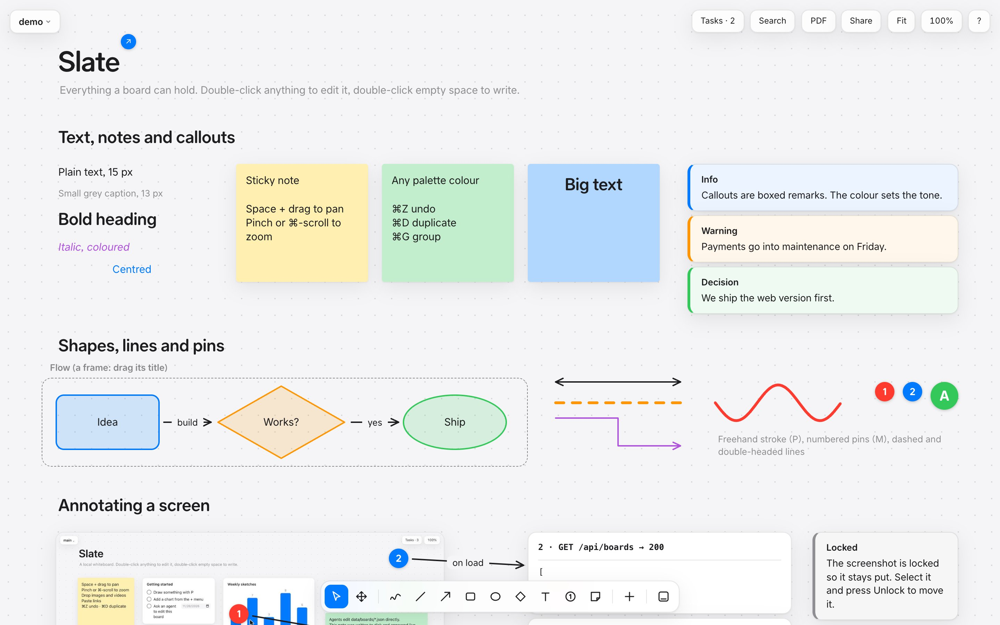
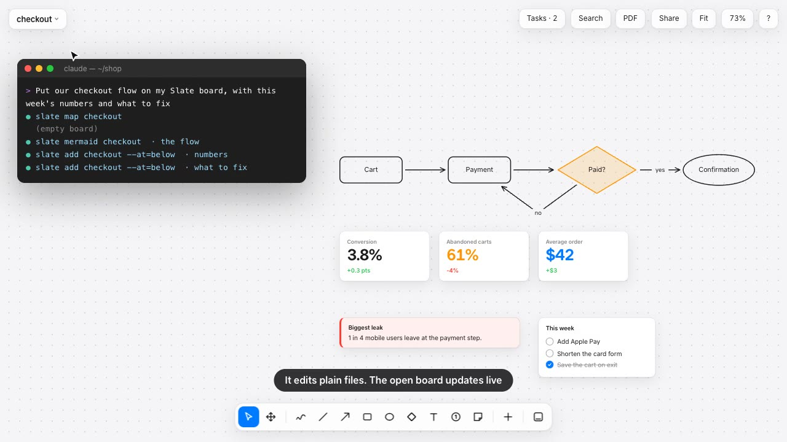

# Slate

**English** · [Türkçe](README.tr.md)

A local whiteboard that AI agents can read and write.



[](docs/slate-demo.mp4)

[▶ Watch the two-and-a-half-minute demo video](docs/slate-demo.mp4) (background music, no voice-over).

Slate runs on your machine, stores every board as a plain JSON file, and has no dependencies. Draw on it yourself, or point a coding agent at the folder and ask it to lay out a plan, a flow or a roadmap. Whatever the agent writes appears on the open board straight away.

## Get started

**1. Install the `slate` command.** It needs [Node.js](https://nodejs.org) 18 or newer. One line puts Slate in `~/.slate`, your boards in `~/Slate`, the `slate` command on your PATH, and teaches Claude Code, Codex and Copilot about it:

```sh
curl -fsSL https://admcilgin.github.io/slate/install.sh | sh
```

Run the same line again to update; your boards stay. Open a new terminal afterwards so `slate` is found. To remove it, `slate uninstall`: it takes away the command, its PATH line and the agent skills, and leaves your boards.

**2. Open your boards.** Either way you see the same files:

- **On the web:** open [admcilgin.github.io/slate](https://admcilgin.github.io/slate) in Chrome, Edge or Brave and pick the `Slate` folder in your home folder. The browser asks once. Nothing is uploaded and there is no account; the page reads and writes the folder on your computer.
- **Locally:** `slate start`, then open the address it prints (http://localhost:4747, or the next free port). Works in every browser.

The first board, `demo`, shows every kind of item. The **?** button in the top-right corner explains all this inside the app.

**3. Ask your agent.** From any project: "put the login flow on my Slate board", "take the next card from my kanban", or select a few items and say "turn these into a task list". What the agent writes shows up on the open board within a second.

### Other ways to run it

- **From a clone:** `git clone https://github.com/admcilgin/slate.git`, then `npm link` inside it for the `slate` command, and `node server.js` (or `slate start`). Boards live in the clone's `data/`. Another port: `PORT=5000 node server.js`.
- **Your own web copy:** put the `public/` folder on any static host with HTTPS. Opened from anywhere but localhost, Slate asks for a folder and keeps the boards there.
- **Another folder:** if you pick a folder other than `~/Slate` on the web, run `slate use <that folder>` once so the CLI, the local server and your agents use it too. `slate status` always says where your boards are.

## What you can put on a board

**Drawing**
- Freehand strokes, lines, arrows, rectangles, ellipses, diamonds
- Arrows that attach to items and follow them, straight or right-angled, with labels, dashed strokes and heads on one or both ends
- Numbered pins for calling out spots on a screenshot

**Writing**
- Text and sticky notes
- Callouts: boxed remarks for info, warnings and decisions
- Code and JSON blocks with syntax colouring, collapse and copy; pasted JSON is formatted automatically
- Mermaid flowcharts become editable shapes and arrows: paste one, or write it with a live preview from + → Mermaid flowchart
- Size, bold, italic, alignment and colour on text, notes, shapes and cards

**Data and planning**
- Metric cards, tables, and bar, line and pie charts
- Task lists with due dates, plus a panel listing every open task on the board
- Kanban boards with cards you drag between columns; a card can carry detail lines under its title (Shift+Enter)
- Timelines

**Media and links**
- Images and videos (drop them on the canvas, paste them, or pick a file)
- Link cards and embeds (YouTube, Vimeo, Figma, Loom)
- Any item can link to a web page or to another board

**Organising**
- Frames: named regions that carry what is inside them
- Grouping, locking, alignment guides while dragging, align and distribute
- Resize from any corner or side; scale a whole selection from its corners
- Multiple boards, each with its own link, and search across all of them
- PDF export of the board, a selection or a frame
- Share: the whole board as one HTML file that opens in any browser, media included

## Using it

| Action | How |
|---|---|
| Edit anything | Double-click it |
| Write text | Double-click empty space |
| Pan | Hold Space and drag, or scroll |
| Zoom | Pinch, or ⌘/Ctrl + scroll |
| Select several | Drag a box, or Shift-click |
| Undo / redo | ⌘Z / ⇧⌘Z |
| Copy / cut / paste, also between boards | ⌘C / ⌘X / ⌘V |
| Duplicate | ⌘D, or Alt-drag |
| Group / ungroup (Alt-click picks one item in a group) | ⌘G / ⇧⌘G |
| Nudge | Arrow keys (Shift for 10 px) |
| Move without snapping | Hold ⌘ while dragging |
| Move a frame with its contents | Drag the frame's title |
| Fit board or selection on screen | F |
| Search all boards | ⌘K |
| Export the selection or the whole board as PDF | ⌘P |
| Send the board to someone as a single HTML file | Share, top right |
| Move the toolbar to the bottom, left, top or right | Last button on the toolbar |
| Delete | Backspace |
| Tools | V select, H pan, P draw, L line, A arrow, R rectangle, O ellipse, D diamond, T text, N note, M numbered pin |

Everything else (images, links, code blocks, tables, tasks, charts, timelines, metric cards, callouts, kanban boards, frames) is in the **+** menu. Select an item to get its options in the bar at the top: colour, text style, dashed, arrowheads, elbow, link, align, lock and so on. Boards are switched, created, renamed and deleted from the menu in the top-left corner.

## Working with an agent

Each board is one file, `data/boards/<name>.json`, with one item per line. An agent reads the file to see the board and edits it to draw. The browser picks up the change in about a tenth of a second, and it lands on your undo stack, so ⌘Z reverts an agent's edit like any other.

[AGENTS.md](AGENTS.md) describes every item type, its fields, the coordinate system and the limits of the platform. Claude Code, Codex and other agents that read `AGENTS.md` or `CLAUDE.md` pick it up automatically when started in this folder. Then ask in plain language:

> Add a timeline of the launch plan to the demo board, and a task list for this week next to it.

There is no built-in chat and no API key to configure. The agent is whichever one you already use.

### From other projects

Agents working elsewhere on your machine use the CLI. It edits board files directly, so neither the browser nor the server has to be running:

```sh
slate status                      # where Slate lives, boards, URL if the server is up or the web copy has them open
slate map demo                    # the layout in few tokens: one line per item, nested by frame, plus free space
slate show demo                   # every item, one per line
slate new "Launch plan"           # create a board
slate add demo '{"type":"note","text":"Ship it"}'
slate add demo '[…]' --at=below   # a batch at 0,0, placed in free space below the board
slate mermaid demo flow.mmd       # a Mermaid flowchart as shapes and arrows
slate copy demo <id> --to=other   # duplicate items, here or onto another board
slate set demo <id> '{"color":"#34c759"}'
slate rm demo <id>
slate start                       # start the server in the background; stop ends it
```

The board also works the other way round, as the thing you point with:

```sh
slate selection                   # what you have selected in the open tab: "make these a task list"
slate wait demo                   # blocks until you change the board, then prints what changed
slate shot demo                   # a PNG the agent can look at: your sketches, or its own layout
slate shot demo <frame-id>        # one frame with its contents
slate pdf demo                    # vector PDF, no print dialog
slate html demo                   # one self-contained HTML file to send to someone
slate cards demo                  # every kanban card with its column and detail
slate move demo "Export to PNG" Doing   # take a card; later move it to Done
```

A kanban works as a task queue for an agent: write a card with the brief in its detail lines, and ask the agent to work the board. It moves the card to your in-progress column when it starts and to done when the work is finished.

With `wait` you can steer an agent without typing to it: circle a part of a screenshot, drop a note that says what to change, and the agent picks it up. `shot` and `pdf` use the Chrome, Chromium, Edge or Brave already on your machine.

Run `slate` with no arguments for the full list. Inside the Slate folder every agent picks up `AGENTS.md` by itself. To teach your agents about Slate in every other project too, install the bundled skill once:

```sh
slate install
```

It installs for each agent it finds on your machine:

| Agent | Skill goes to |
|---|---|
| Claude Code | `~/.claude/skills/slate` |
| Codex | `~/.codex/skills/slate` (or `$CODEX_HOME/skills/slate`) |
| GitHub Copilot (CLI, VS Code agent mode) | `~/.copilot/skills/slate` |

The installer does this for you. An agent you install later is picked up by running `slate install` again. After that you can say "put this flow on my Slate board" from any repo.

## Your data

- Boards live in `~/Slate/boards/` (in `data/boards/` for a clone), uploaded media next to them in `assets/`. Updating Slate never touches them, and they are not shared between computers. `slate status` shows the folder.
- To move boards to another computer, copy that folder and run `slate use <folder>` there.
- The server listens on `127.0.0.1` only and rejects requests from other sites.
- Nothing is sent anywhere. Embeds and remote images load from their own hosts when you add them.

## Limits

- One person at a time: if you and an agent save within the same quarter-second, the last write wins.
- Text inside an item is plain. Style applies to the whole item, not to single words.
- Items cannot be rotated, and groups cannot be nested.
- A shared HTML file is a copy: whoever opens it can move things around, but nothing is saved and it does not sync back. Embeds in it need a connection, and some (YouTube) refuse to play from a local file.
- Scaling a selection changes positions and sizes, not text size.

## Code

About 2,400 lines, no build step.

- `cli.js` reads and edits boards from the command line; `lib.js` holds what it shares with the server.
- `server.js` serves the app, reads and writes board files, and pushes live-reload events.
- `public/folder.js` stands in for the server on a static host, keeping boards in a folder the user picks.
- `public/mermaid.js` turns a Mermaid flowchart into shapes and arrows, for the + menu, paste and `slate mermaid`.
- `public/app.js` is the canvas. Each item type has one renderer in `R` and its defaults in `DEF`.
- `demo.json` is the showcase board copied on first run.

## License

[MIT](LICENSE). Free to use, change and ship, for personal or commercial work. Keep the copyright notice.
