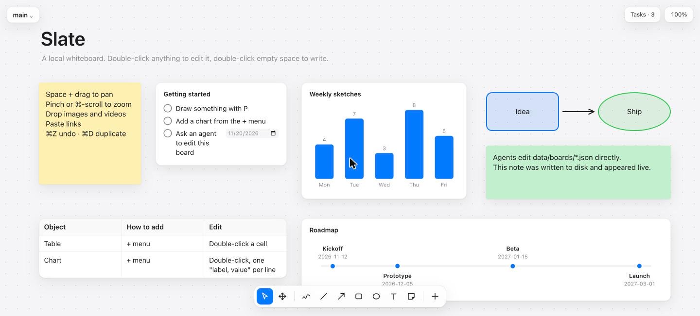

# Slate

A local whiteboard that AI agents can read and write.



Slate runs on your machine, stores every board as a plain JSON file, and has no dependencies. Draw on it yourself, or point a coding agent at the folder and ask it to lay out a plan, a chart or a roadmap. Whatever the agent writes appears on the open board straight away.

## Run it

Needs [Node.js](https://nodejs.org) 18 or newer. Nothing to install.

```sh
git clone https://github.com/admcilgin/slate.git
cd slate
node server.js
```

Open http://localhost:4747. To use another port: `PORT=5000 node server.js`.

## What you can put on a board

- Freehand drawing, lines, arrows, rectangles, ellipses
- Text and sticky notes, with size, bold, italic, alignment and colour
- Images and videos (drop them on the canvas, paste them, or pick a file)
- Links and embeds (YouTube, Vimeo, Figma, Loom)
- Task lists with due dates, plus a panel listing every open task on the board
- Code and JSON blocks with syntax colouring, collapse and copy; pasted JSON is formatted automatically
- Arrows that attach to items and follow them, with labels and draggable ends
- Numbered pins for calling out spots on a screenshot
- Grouping, locking, alignment guides while dragging
- Search across all boards
- Tables
- Bar, line and pie charts
- Timelines
- Multiple boards, each with its own link

## Using it

| Action | How |
|---|---|
| Edit anything | Double-click it |
| Write text | Double-click empty space |
| Pan | Hold Space and drag, or scroll |
| Zoom | Pinch, or ⌘/Ctrl + scroll |
| Select several | Drag a box, or Shift-click |
| Undo / redo | ⌘Z / ⇧⌘Z |
| Copy / cut / paste, also between boards | ⌘C / ⌘X / ⌘V |
| Duplicate | ⌘D |
| Group / ungroup (Alt-click picks one item in a group) | ⌘G / ⇧⌘G |
| Nudge | Arrow keys (Shift for 10 px) |
| Move without snapping | Hold ⌘ while dragging |
| Fit board or selection on screen | F |
| Search all boards | ⌘K |
| Delete | Backspace |
| Tools | V select, H pan, P draw, L line, A arrow, R rectangle, O ellipse, T text, N note, M numbered pin |

Everything else (images, links, tables, tasks, charts, timelines, metric cards, callouts, kanban boards) is in the **+** menu. Boards are switched, created, renamed and deleted from the menu in the top-left corner.

## Working with an agent

Each board is one file, `data/boards/<name>.json`, with one item per line. An agent reads the file to see the board and edits it to draw. The browser picks up the change in about a tenth of a second, and it lands on your undo stack, so ⌘Z reverts an agent's edit like any other.

[AGENTS.md](AGENTS.md) describes every item type, its fields, the coordinate system and the limits of the platform. Claude Code, Codex and other agents that read `AGENTS.md` or `CLAUDE.md` pick it up automatically when started in this folder. Then ask in plain language:

> Add a timeline of the launch plan to the demo board, and a task list for this week next to it.

There is no built-in chat and no API key to configure. The agent is whichever one you already use.

### From other projects

Agents working elsewhere on your machine use the CLI. It edits board files directly, so neither the browser nor the server has to be running:

```sh
node cli.js status                      # where Slate lives, boards, URL if the server is up
node cli.js show demo                   # every item, one per line
node cli.js add demo '{"type":"note","text":"Ship it"}'
node cli.js set demo <id> '{"color":"#34c759"}'
node cli.js rm demo <id>
```

Run `node cli.js` for the full list. To teach Claude Code about Slate in every project, install the bundled skill once:

```sh
node cli.js install
```

After that you can say "put this flow on my Slate board" from any repo.

## Your data

- Boards live in `data/boards/`, uploaded media in `data/assets/`. Both are git-ignored.
- The server listens on `127.0.0.1` only and rejects requests from other sites.
- Nothing is sent anywhere. Embeds and remote images load from their own hosts when you add them.

## Limits

One person at a time: if you and an agent save within the same quarter-second, the last write wins. There are no frames or nested groups, rich text inside items, or links between boards.

## Code

About 1,200 lines, no build step.

- `cli.js` reads and edits boards from the command line; `lib.js` holds what it shares with the server.
- `server.js` serves the app, reads and writes board files, and pushes live-reload events.
- `public/app.js` is the canvas. Each item type has one renderer in `R` and its defaults in `DEF`.
- `demo.json` is the welcome board copied on first run.
