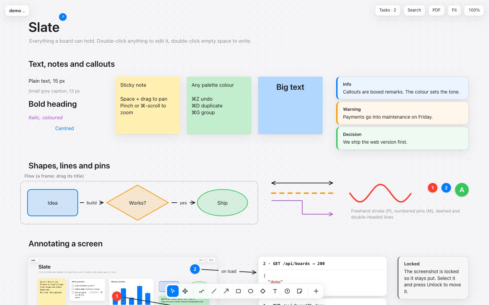
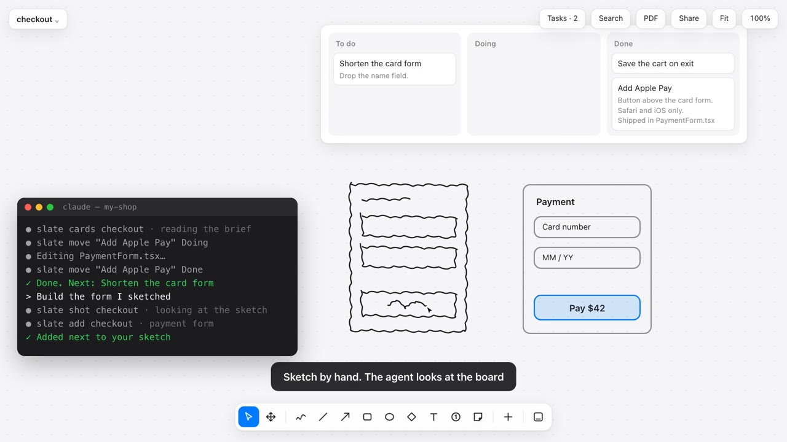

# Slate

[English](README.md) · **Türkçe**

Yapay zekâ ajanlarının okuyup yazabildiği, bilgisayarınızda çalışan bir beyaz tahta.



[](docs/slate-demo.mp4)

[▶ İki dakikalık tanıtım videosunu izle](docs/slate-demo.mp4) (sessiz, İngilizce yazılı).

Slate kendi bilgisayarınızda çalışır, her panoyu düz bir JSON dosyası olarak saklar ve hiçbir bağımlılığı yoktur. Kendiniz çizebilir ya da bir kod ajanına klasörü gösterip bir plan, akış veya yol haritası çizmesini isteyebilirsiniz. Ajanın yazdığı her şey açık panoda hemen görünür.

## Çalıştırma

[Node.js](https://nodejs.org) 18 veya üstü gerekir. Kurulacak başka bir şey yoktur.

```sh
git clone https://github.com/admcilgin/slate.git
cd slate
node server.js
```

http://localhost:4747 adresini açın. Başka bir port için: `PORT=5000 node server.js`.

İlk açılışta, tüm öğe türlerini gösteren `demo` adlı bir pano gelir.

## Panoya neler konabilir

**Çizim**
- Serbest çizim, çizgi, ok, dikdörtgen, elips, baklava
- Öğelere bağlanan ve onları takip eden oklar: düz veya dik açılı, etiketli, kesikli, tek ya da çift uçlu
- Ekran görüntüsü üzerindeki noktaları işaretlemek için numaralı işaretler

**Yazı**
- Metin ve yapışkan notlar
- Uyarı kutuları: bilgi, uyarı ve karar notları için
- Sözdizimi renklendirmeli, daraltılabilen ve kopyalanabilen kod ve JSON blokları; yapıştırılan JSON kendiliğinden biçimlenir
- Metin, not, şekil ve kartlarda boyut, kalın, italik, hizalama ve renk

**Veri ve planlama**
- Metrik kartları, tablolar; çubuk, çizgi ve pasta grafikler
- Bitiş tarihli görev listeleri ve panodaki tüm açık görevleri gösteren panel
- Kartları sütunlar arasında sürüklenen kanban panoları; kartın başlığının altına detay satırları yazılabilir (Shift+Enter)
- Zaman çizelgeleri

**Medya ve linkler**
- Görsel ve video (tuvale sürükleyin, yapıştırın ya da dosya seçin)
- Link kartları ve gömülü içerik (YouTube, Vimeo, Figma, Loom)
- Her öğe bir web sayfasına ya da başka bir panoya link verebilir

**Düzen**
- Çerçeveler: içindekileri birlikte taşıyan, adlandırılmış bölgeler
- Gruplama, kilitleme, sürüklerken hizalama kılavuzları, hizala ve eşit dağıt
- Her köşeden ve kenardan boyutlandırma; çoklu seçimi köşelerinden ölçekleme
- Her biri kendi linkine sahip birden çok pano ve hepsinde arama
- Panonun, seçimin ya da bir çerçevenin PDF olarak dışa aktarımı
- Paylaşım: panonun tamamı, medyasıyla birlikte, her tarayıcıda açılan tek bir HTML dosyası olarak

## Kullanım

| İşlem | Nasıl |
|---|---|
| Herhangi bir şeyi düzenle | Çift tıkla |
| Metin yaz | Boş alana çift tıkla |
| Kaydır | Space basılıyken sürükle ya da kaydır |
| Yakınlaştır | İki parmakla sıkıştır ya da ⌘/Ctrl + kaydır |
| Birden çok öğe seç | Kutu çiz ya da Shift ile tıkla |
| Geri al / yinele | ⌘Z / ⇧⌘Z |
| Kopyala / kes / yapıştır (panolar arasında da) | ⌘C / ⌘X / ⌘V |
| Çoğalt | ⌘D ya da Alt ile sürükle |
| Grupla / grubu çöz (Alt-tık gruptan tek öğe seçer) | ⌘G / ⇧⌘G |
| İnce kaydır | Ok tuşları (Shift ile 10 px) |
| Yapışmadan taşı | Sürüklerken ⌘ basılı tut |
| Çerçeveyi içindekilerle taşı | Çerçevenin başlığından sürükle |
| Panoyu ya da seçimi ekrana sığdır | F |
| Tüm panolarda ara | ⌘K |
| Seçimi ya da tüm panoyu PDF olarak dışa aktar | ⌘P |
| Panoyu tek bir HTML dosyası olarak birine gönder | Sağ üstteki Share |
| Araç çubuğunu alta, sola, üste ya da sağa taşı | Araç çubuğundaki son düğme |
| Sil | Backspace |
| Araçlar | V seç, H kaydır, P çiz, L çizgi, A ok, R dikdörtgen, O elips, D baklava, T metin, N not, M numaralı işaret |

Geri kalan her şey (görsel, link, kod bloğu, tablo, görev listesi, grafik, zaman çizelgesi, metrik kartı, uyarı kutusu, kanban, çerçeve) **+** menüsündedir. Bir öğeyi seçince seçenekleri üstteki çubukta çıkar: renk, yazı stili, kesikli çizgi, ok uçları, dik açılı ok, link, hizalama, kilit ve benzeri. Panolar sol üstteki menüden değiştirilir, oluşturulur, yeniden adlandırılır ve silinir.

## Ajanla çalışma

Her pano tek bir dosyadır: `data/boards/<ad>.json`, her satırda bir öğe. Ajan panoyu görmek için dosyayı okur, çizmek için dosyayı düzenler. Tarayıcı değişikliği saniyenin onda biri kadar bir sürede alır ve geri alma geçmişinize ekler; yani ⌘Z ajanın değişikliğini de geri alır.

[AGENTS.md](AGENTS.md) her öğe türünü, alanlarını, koordinat sistemini ve platformun sınırlarını anlatır. Claude Code, Codex ve `AGENTS.md` ya da `CLAUDE.md` okuyan diğer ajanlar bu klasörde başlatıldıklarında onu kendiliğinden okur. Sonra düz bir dille isteyin:

> Demo panosuna lansman planının zaman çizelgesini, yanına da bu haftanın görev listesini ekle.

Yerleşik bir sohbet ya da ayarlanacak bir API anahtarı yoktur. Ajan, zaten kullandığınız ajandır.

### Başka projelerden

Bilgisayarınızın başka bir yerinde çalışan ajanlar komut satırı aracını kullanır. Araç pano dosyalarını doğrudan düzenler; tarayıcının ya da sunucunun açık olması gerekmez:

```sh
node cli.js status                      # Slate nerede, panolar, sunucu açıksa adresi
node cli.js show demo                   # tüm öğeler, satır başına bir tane
node cli.js new "Lansman planı"         # pano oluştur
node cli.js add demo '{"type":"note","text":"Yayınla"}'
node cli.js set demo <id> '{"color":"#34c759"}'
node cli.js rm demo <id>
node cli.js start                       # sunucuyu arka planda başlat; stop durdurur
```

Pano ters yönde de çalışır: ajana bir şeyi göstermek için kullanırsınız.

```sh
node cli.js selection                   # açık sekmede seçtikleriniz: "bunları görev listesi yap"
node cli.js wait demo                   # siz panoyu değiştirene kadar bekler, sonra neyin değiştiğini yazar
node cli.js shot demo                   # ajanın bakabileceği bir PNG: sizin çizimleriniz ya da kendi yerleşimi
node cli.js shot demo <çerçeve-id>      # tek bir çerçeve, içindekilerle
node cli.js pdf demo                    # vektör PDF, yazdırma penceresi olmadan
node cli.js html demo                   # birine göndermek için tek dosyalık HTML
node cli.js cards demo                  # tüm kanban kartları, sütunu ve detayıyla
node cli.js move demo "Export to PNG" Doing   # kartı üstlen; bitince Done'a taşı
```

Kanban, ajan için bir iş kuyruğu olarak çalışır: kartı yazın, ne istediğinizi detay satırlarına koyun ve ajandan panodaki işleri yapmasını isteyin. Başlarken kartı "yapılıyor" sütununuza, iş bitince "bitti" sütununuza taşır.

`wait` ile ajana yazmadan yön verirsiniz: ekran görüntüsünde bir yeri yuvarlak içine alın, ne değişeceğini söyleyen bir not bırakın, ajan onu alır. `shot` ve `pdf`, bilgisayarınızda zaten kurulu olan Chrome, Chromium, Edge ya da Brave'i kullanır.

Tam liste için `node cli.js` çalıştırın. Claude Code'un Slate'i her projede tanıması için birlikte gelen skill'i bir kez kurun:

```sh
node cli.js install
```

Bundan sonra herhangi bir repodan "bu akışı Slate panoma koy" diyebilirsiniz.

## Verileriniz

- Panolar `data/boards/`, yüklenen medya `data/assets/` klasöründedir. İkisi de git tarafından yok sayılır; yani `git pull` panolarınıza dokunmaz ve panolar bilgisayarlar arasında paylaşılmaz.
- Panoları başka bir bilgisayara taşımak için `data/` klasörünü kopyalayın.
- Sunucu yalnızca `127.0.0.1` üzerinde dinler ve başka sitelerden gelen istekleri reddeder.
- Hiçbir yere veri gönderilmez. Gömülü içerikler ve uzaktaki görseller, eklediğinizde kendi sunucularından yüklenir.

## Sınırlar

- Aynı anda tek kişi: siz ve bir ajan aynı çeyrek saniye içinde kaydederseniz son yazan kazanır.
- Öğelerin içindeki metin düz metindir. Stil öğenin tamamına uygulanır, tek tek kelimelere değil.
- Öğeler döndürülemez, gruplar iç içe olamaz.
- Paylaşılan HTML dosyası bir kopyadır: açan kişi öğeleri oynatabilir ama hiçbir şey kaydedilmez ve geri eşitlenmez. İçindeki gömülü içerikler bağlantı ister; bazıları (YouTube) yerel dosyadan oynamaz.
- Bir seçimi ölçeklemek konumları ve boyutları değiştirir, yazı boyutunu değiştirmez.

## Kod

Yaklaşık 1.900 satır, derleme adımı yok.

- `cli.js` panoları komut satırından okur ve düzenler; `lib.js` sunucuyla ortak kısımları tutar.
- `server.js` uygulamayı sunar, pano dosyalarını okuyup yazar ve canlı yenileme olaylarını gönderir.
- `public/app.js` tuvalin kendisidir. Her öğe türünün `R` içinde bir çizicisi, `DEF` içinde varsayılanları vardır.
- `demo.json` ilk açılışta kopyalanan tanıtım panosudur.

## Lisans

[MIT](LICENSE). Kişisel ya da ticari her işte serbestçe kullanabilir, değiştirebilir ve dağıtabilirsiniz. Telif bildirimini korumanız yeterli.
